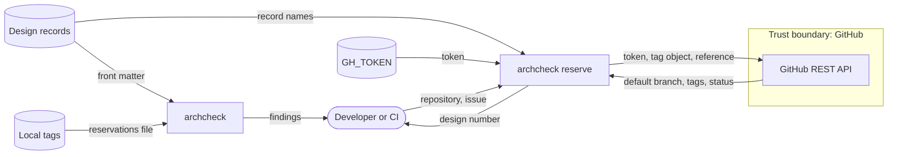

# 0005: Annotated tags in GitHub reserve design numbers

Date: 2026-11-22.

## Context

Each branch selects the next free design number when it starts, so two open branches can select the same number.
A reservation must give each number to one caller, also when two callers start at the same time.
The checker starts no processes, so it cannot run `git` or `gh`.

## Decision

A reservation is an annotated tag `refs/tags/design/NNNN` in the GitHub repository.
The message of the tag is `issue: N`.

`archcheck reserve` creates the tag object, and then the reference, through the GitHub REST API.
GitHub rejects a reference that exists with `422 Reference already exists`, so one caller gets each number.

The command uses `net/http` and `encoding/json` from the standard library for five endpoints.
It selects one more than the largest number of the local records and the existing tags, up to `9999`.

It tries the next number only on `Reference already exists`.
Any other failure stops the command.

When a reference request gets no response, the command stops and reports that the outcome is unknown.
Two callers can create identical tag objects, so the SHA of a reference does not show which caller created it.
The command never changes or deletes a reference.

The record check stays offline.
`-reservations` names a file that `git for-each-ref` writes, with the reference name, the object type and the subject of each tag.
`internal/record` parses that file and compares each record with its tag.

## Security

| Asset or boundary | Threat | Control |
| --- | --- | --- |
| The token in `GH_TOKEN` | Disclosure in output, URLs or a different host | The token goes only in the `Authorization` header to `https://api.github.com`. The client follows no redirects, and no error message contains the token. |
| The reservation namespace | Two callers get the same number | Only reference creation reserves a number, and GitHub creates each reference one time. |
| The reservation namespace | A loop that uses up numbers | Only `Reference already exists` moves to the next number, and the numbers stop at `9999`. |
| The command | A slow or large response | Each request has a time limit and the command context. Each response body has a size limit. |
| The reservations file | A wrong or incomplete file hides a missing reservation | A malformed line or a duplicate tag stops the check. Only an annotated tag counts as a reservation. |

The reservations file is evidence from the caller, not a signed proof.
The caller must fetch the tags from the correct remote before the check.

## Data flow

## Alternatives

- A counter file in the repository. Two branches change the same line, and the conflict appears only at merge.
- `git push` of a tag. The checker starts no processes.
- `github.com/google/go-github`. It is a large module for five endpoints.
- A record check that reads the tags from GitHub. Each ordinary check then needs the network and a token.

## Consequences

A repository with records needs a tag for each record before it turns on the check.
Numbers that a caller reserves and does not use stay as gaps.
The check cannot find two branches that use the same tag for the same issue.
