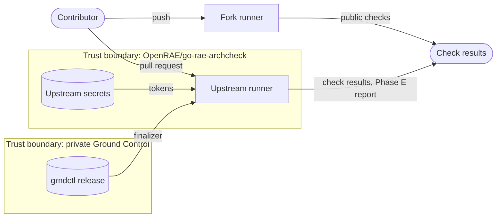

# 0006: Forks and contributors need no maintainer services

Date: 2026-11-25.

## Context

Ground Control is private maintainer tooling, and its source and releases are not public.
Some jobs use upstream secrets, the upstream maintainer or the private Ground Control release.
These jobs fail in a fork.

The configuration check also read `.ground-control.yaml` and rejected a repository other than upstream.
Thus the `Check` job failed in each fork.

## Decision

The public checks need no Ground Control.
`make ci-check` and `scripts/check_config.py` do not read `.ground-control.yaml`.
The title workflow owns the title rules, and `sonar-project.properties` owns the Sonar settings.

A job that needs an upstream service runs only when `github.repository_id` is `1442018845`.
That number is the ID of `OpenRAE/go-rae-archcheck`.

A rename or a transfer keeps the ID, and each fork has a different ID.
Thus a rename cannot turn an upstream check into a skipped pass.

| Workflow | Job | Upstream need |
| --- | --- | --- |
| `ci.yml` | `sonar` | `SONAR_TOKEN` |
| `secret-scan.yml` | `ggshield` | `GITGUARDIAN_API_KEY` |
| `maintainer-gate.yml` | `maintainer-gate` | The upstream maintainer |
| `ground-control-phase-e.yml` | `finalize` | `GROUND_CONTROL_READ_TOKEN` and the private release |
| `release-please.yml` | `release-please` | The upstream releases |
| `sync-main-to-dev.yml` | `backmerge` | The upstream back-merge |
| `scorecard.yml` | `scorecard` | The published upstream results |

`scripts/check_config.py` holds the exact condition of each of these jobs, and CI rejects a different condition.
Upstream merge groups still run each required producer.

A push or a manual run compares with its own commit, because its pull request or merge group checks already ran.
Thus a fork without a `dev` branch passes the regression and architecture checks.

`.ground-control.yaml`, `.gc/plan_rules.md` and `.github/ground-control/` stay as inert maintainer configuration.
The maintainer keeps the MCP configuration in an untracked `.mcp.json`.
No tracked file tells contributors or agents to install or use Ground Control.

## Security

| Threat | Control |
| --- | --- |
| A guard skips a required check upstream | The guard uses the repository ID, which a rename keeps. `scripts/check_config.py` rejects any other condition. |
| A fork job uses upstream secrets | GitHub gives no repository secrets to a fork. The guard also stops each upstream job before its first step. |
| The Ground Control configuration drifts from the workflows | Residual risk. The maintainer keeps them the same, as `.gc/plan_rules.md` states. |

## Data flow

## Consequences

A fork runs `Check`, CodeQL and the title check, and skips the upstream jobs.
A fork that wants SonarCloud or GitGuardian must change the guard and add its own secrets.
Pull requests from forks to upstream keep the upstream checks.
