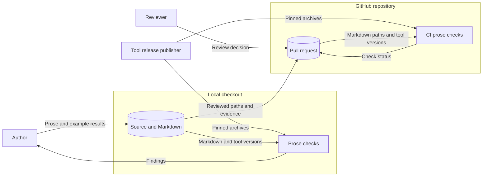

# 0008: Organize documentation by reader need

Date: 2026-11-28.

## Context

The README and model reference contain both procedures and facts.
A reader needs a short lesson, steps for real work, exact rules, and reasons for design decisions.

## Decision

Apply the [Diátaxis compass](https://diataxis.fr/compass/) to maintained documentation.
Use the README to describe the checker and link to the pages below.
Keep existing page paths and heading links where possible.

| Reader need | Page |
| --- | --- |
| Learn to use the checker | Add `docs/tutorial.md`. Use a small Go module to show a successful check and a finding. |
| Check an existing module | Add `docs/check-module.md`. Give the steps to install and run the checker and reserve a design number. |
| Find exact checker rules | Keep `docs/model.md` as the reference for the model, records, command flags, and exit statuses. |
| Understand design decisions | Use `docs/decisions/README.md` to find decision records. Link to design records for the changes that they describe. |
| Contribute or report a problem | Keep `CONTRIBUTING.md` and `SECURITY.md` as task guides. Keep the conduct policy and agent and review instructions at their existing paths. |

Treat command help, Go package documentation, and schema descriptions as reference.
Keep the license, generated release history, and test fixtures in their existing formats.

Check facts in historical records against the revision that each record describes.
Keep the file names and front matter that the checker reads from `architecture/designs`.

## Verification

Use the shared documentation skill and the pinned doc-tools release from [issue #14](https://github.com/OpenRAE/go-archcheck/issues/14).
Check each changed section against the source, schema, tests, or configuration that defines its behavior.
Run new or changed examples and record the reference revision and results in the pull request.

Use ASD-STE100 Simplified Technical English for maintained prose.
To check changed Markdown files, run `make prose` with their paths in `PROSE_PATHS`.
Review reader purpose, technical meaning, and word use separately from the automated checks.

The default check reads tracked Markdown paths from Git, with test fixtures excluded.
Pass each path from Git as one file argument to both tools.

## Data flow

## Security

The Makefile verifies the doc-tools archive before extraction. The doc-tools installer then verifies the ste-cli archive.

Keep credentials and private report details out of examples and pull requests. Use the private route in [the security policy](../../SECURITY.md).

Review example commands before execution. Prose checks can miss an unsafe command or an incorrect fact.

## Consequences

The repository uses plain Markdown and its current GitHub checks.
The README will link to the lesson and task guide when those pages are available.
Each page has one main purpose.
